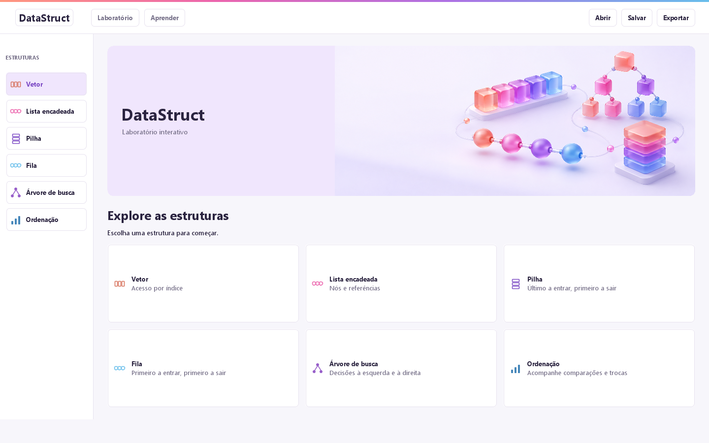

# DataStruct

Aplicação Java para estudar estruturas de dados por meio de operações visuais. O projeto parte do TCC **DataStruct — Desenvolvimento de uma Ferramenta Computacional Interativa para Apoio ao Aprendizado de Estruturas de Dados**, de Deivid Allan de Oliveira Almeida. O laboratório coloca a estrutura no centro, as operações à direita e os controles de execução embaixo. O aprendizado acontece manipulando dados e acompanhando os algoritmos.



## Executar o aplicativo

Baixe [DataStruct.jar](dist/DataStruct.jar) e abra com Java 17 ou superior. Não é necessário instalar o VS Code para utilizar o sistema.

```shell
java -jar DataStruct.jar
```

## Compilar e executar no VS Code

Para compilar, instale o JDK 17 ou superior. Abra esta pasta no VS Code e, no terminal PowerShell, execute:

```powershell
powershell -ExecutionPolicy Bypass -File .\run.ps1
```

Se o suporte Java do VS Code estiver instalado, também é possível iniciar pela configuração **DataStruct** no painel Executar e Depurar.

Para rodar as verificações automatizadas:

```powershell
powershell -ExecutionPolicy Bypass -File .\test.ps1
```

Para gerar um aplicativo `.jar` executável:

```powershell
powershell -ExecutionPolicy Bypass -File .\build.ps1
java -jar .\dist\DataStruct.jar
```

O projeto não precisa de Maven, Gradle nem bibliotecas externas.

## Estruturas e operações

| Módulo | Operações disponíveis |
| --- | --- |
| Vetor de capacidade configurável (1–64) | criar/redimensionar, inserir ao fim, remover por índice, buscar, atualizar |
| Lista simplesmente encadeada | inserir no início, fim ou índice; remover por valor ou posição; buscar |
| Pilha dinâmica | empilhar, desempilhar, consultar topo |
| Fila dinâmica | enfileirar, desenfileirar, consultar início |
| Árvore binária de busca | inserir, remover, buscar, percorrer em ordem |
| Ordenação | bolha, inserção, embaralhar e editar o conjunto de valores |

## Como explorar

1. Na capa, escolha uma estrutura. Use **Laboratório** para manipular os dados e **Aprender** para estudar conceitos, regras, custos e exemplos. Clique em **DataStruct** para voltar à capa. Em janelas menores, o laboratório também oferece um seletor junto ao título.
2. Use **Exemplo** ou escolha uma inserção e digite valores como `12, 7, 24`. Vírgulas, espaços e ponto e vírgula são aceitos. Pressione Enter ou o botão da operação.
3. Clique em um elemento do desenho para preencher seu valor e sua posição. Os índices começam em zero.
4. Marque **Animar operação** para acompanhar os passos. Use **Anterior**, **Próximo**, **Pausar**, a linha do tempo e a velocidade. **Concluir** mostra imediatamente o resultado; **Rever** reproduz a operação novamente.
5. Acompanhe o painel **Código Java**. Em áreas largas, ele aparece ao lado do desenho; em áreas menores, selecione a aba **Código Java**. A execução, os campos e a linha do tempo continuam disponíveis. **Histórico** reúne as operações já executadas.

## Vetores com capacidade própria

Clique em **Capacidade** no painel de operações e escolha de 1 a 64 posições. A capacidade reserva vagas; o tamanho indica quantas estão ocupadas. Aumentar a capacidade preserva os dados. Reduzir só é permitido quando todos os valores cabem; **Começar com um vetor vazio** permite criar um menor. Toda essa configuração pode ser desfeita e é salva na sessão. Exemplos e geração de valores respeitam a capacidade escolhida.

## Código e explicações

O painel Java lê uma cópia de `Simulator.java` incluída no aplicativo. Cada quadro registra o método e a linha que o emitiu. Essa linha fica destacada, acompanhando reprodução, pausa, avanço e retorno; ela contém a chamada `add(...)` que registra o estado e a explicação. As instruções do algoritmo aparecem no mesmo trecho. É uma execução instrumentada dos algoritmos internos, não um depurador para programas externos.

A seção **Aprender** aborda vetores, listas, pilhas, filas, árvores de busca e ordenação, com regras, exemplos de exploração, custos assintóticos e cuidados comuns. O painel principal mantém apenas os controles e a explicação do passo atual.

**Editar todos os valores** permite montar seu próprio conjunto, inclusive para ordenação. Na pilha, a edição lista os valores do topo para a base; inserções em lote empilham na ordem digitada. Na árvore, a ordem digitada determina sua forma. Na lista, inserir vários valores por posição mantém a ordem digitada; inserir no início repetidamente coloca o último valor no começo.

**Gerar…** cria um conjunto com quantidade e intervalo escolhidos por você. A árvore recebe valores únicos; nas outras estruturas, repetições são permitidas. A geração pode ser desfeita.

## Interação com os elementos

- **Arrastar:** reposiciona os blocos de vetor, lista, pilha, fila e árvore. As setas acompanham os nós; os índices e a ordem lógica permanecem iguais. Na ordenação, as barras mantêm sua posição para preservar a leitura do gráfico.
- **Organizar:** restaura a disposição automática. O ajuste de zoom continua funcionando após mover os blocos e redimensionar a janela.
- **Duplo clique:** edita o valor selecionado; na próxima vaga livre do vetor, insere um valor. Na árvore, a troca remove o valor antigo e insere o novo conforme as regras de busca. Valores duplicados são rejeitados.
- **Botão direito:** abre ações para editar, remover ou buscar, conforme a estrutura. Na lista, a remoção por posição distingue nós com valores iguais. Na pilha, a remoção está disponível no topo; na fila, no início.

Durante a reprodução, clicar em um elemento pausa a animação. Para editar os dados de um quadro intermediário, primeiro use **Concluir**. O arraste organiza a visualização mesmo durante a pausa. Alterações diretas de valores são edição do conjunto; use o painel de operações para estudar a execução passo a passo.

**Desfazer** e **Refazer** recuperam alterações completas, inclusive lotes, limpeza, exemplos e abertura de sessão. Um lote inválido não altera parcialmente a estrutura. O histórico de desfazer guarda até 60 alterações da sessão inteira.

A janela inicia maximizada na capa. **Ajustar** enquadra o desenho inteiro; percentuais de 50% a 200% permitem examinar os detalhes com rolagem. Vetores, listas e filas distribuem os elementos conforme a área disponível. **Exportar** salva o desenho do passo exibido em PNG.

**Salvar** grava todos os módulos em `.dsxml`, incluindo a capacidade do vetor; **Abrir** restaura os valores e o formato da árvore. Sessões antigas continuam aceitas com capacidade 10. Arquivos de sessão não incluem posições manuais dos blocos, histórico de operações, desfazer ou reprodução. **Desfazer** recupera dados; para desfazer a organização visual manual, use **Organizar**. Valores aceitos vão de -999 a 999, com até 64 posições no vetor e 20 elementos nas demais estruturas.

Atalhos: **Ctrl+Z** desfaz, **Ctrl+Y** refaz, **Ctrl+S** salva e **Ctrl+O** abre uma sessão.

## Organização

- `src/datastruct/core`: estruturas, simulação, conteúdo didático e formato XML.
- `src/datastruct/ui`: janela e desenhos. A interface só lê quadros imutáveis da simulação.
- `assets/cover.png`: ilustração da tela inicial.
- `resources.ps1`: empacota a capa e o código-fonte exibido pelo laboratório. Chamado pelos scripts de execução, compilação e teste.
- `test/datastruct`: verificações dos algoritmos, XML, edição em lote, desfazer/refazer, geração, edição direta, seleção, arraste e renderização da interface completa em quatro tamanhos de janela.

## Contexto acadêmico

Projeto de TCC de Deivid Allan de Oliveira Almeida. A avaliação com estudantes está prevista como etapa da pesquisa; os testes de software verificam o funcionamento da aplicação e não constituem evidência de eficácia pedagógica.

O EasyDS é uma referência de ambiente visual para estudo de estruturas de dados. O [TerraER](https://www.terraer.com.br/) é uma referência para a organização da área de trabalho e das operações de arquivo.
